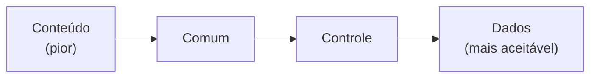
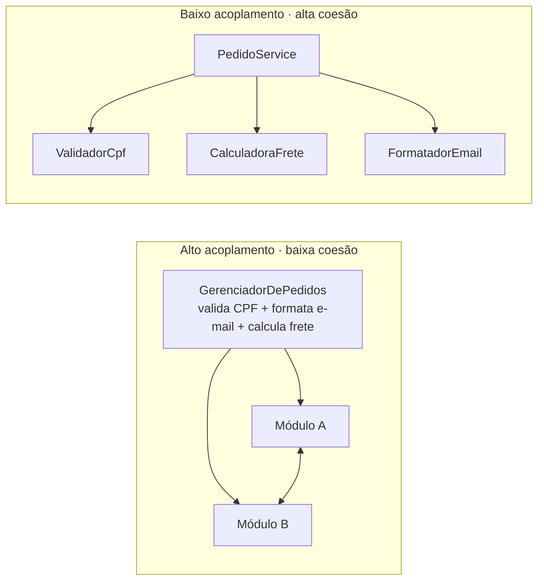

# 2. Acoplamento e coesão

**Acoplamento** descreve o quanto um módulo depende de outros. **Coesão** descreve o quanto os atributos e métodos de um módulo trabalham juntos para um único propósito. A meta é **alta coesão e baixo acoplamento**.

## Tipos de acoplamento

Do menos desejável ao mais aceitável:

| Tipo | Quando ocorre | Exemplo |
|---|---|---|
| **Conteúdo** | Um módulo acessa ou modifica dados internos de outro. Viola o encapsulamento. | Alterar diretamente `pedido._itens` de outro módulo. |
| **Comum** | Módulos compartilham uma área de dados global. | Vários módulos leem e escrevem `estadoGlobal`. |
| **Controle** | Um módulo envia uma informação que controla o fluxo interno de outro. | `processar(pedido, modoDetalhado)` define um ramo interno. |
| **Dados** | Módulos trocam apenas os dados necessários por parâmetros bem definidos. | `calcularFrete(endereco, peso)`. |

## Coesão na prática

Um `GerenciadorDePedidos` que valida CPF, formata e-mails e calcula frete reúne responsabilidades sem relação direta. Separar essas responsabilidades torna cada módulo mais coeso e facilita mudanças localizadas.

## Checklist de diagnóstico

- [ ] Uma mudança em uma classe me obriga a retestar dezenas de outras?
- [ ] Corrigir um bug cria outro aparentemente sem relação?
- [ ] É difícil explicar a classe em uma frase?
- [ ] Há acesso direto aos detalhes internos de outro módulo?
- [ ] As integrações compartilham estado ou controlam o fluxo interno umas das outras?

Esses sintomas práticos são mais úteis que perseguir uma métrica numérica isolada.
