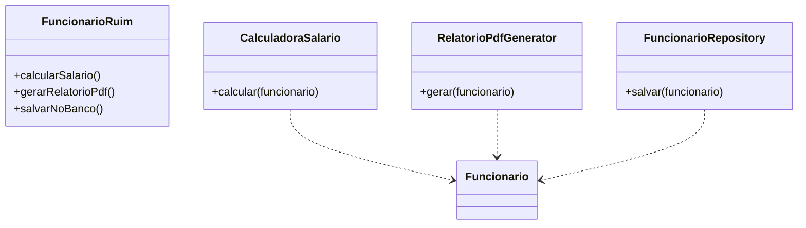
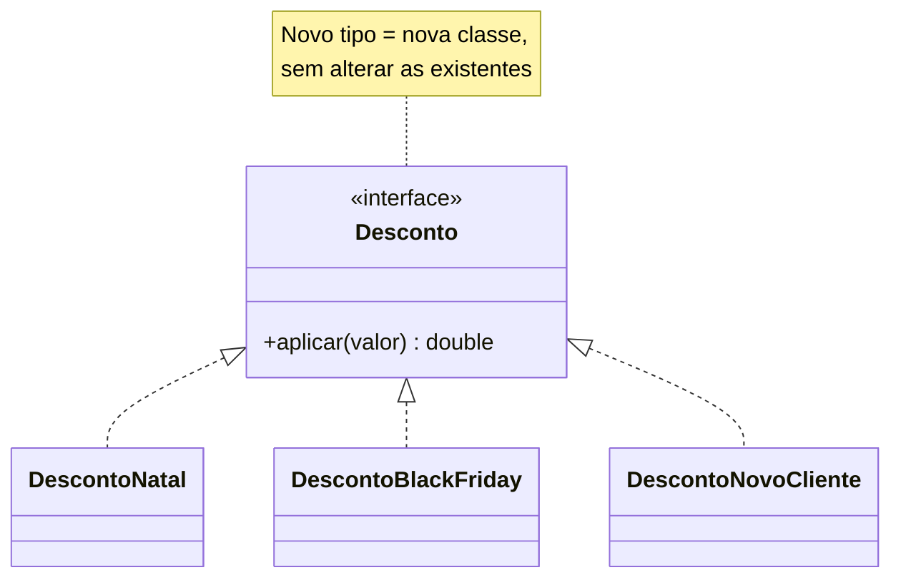
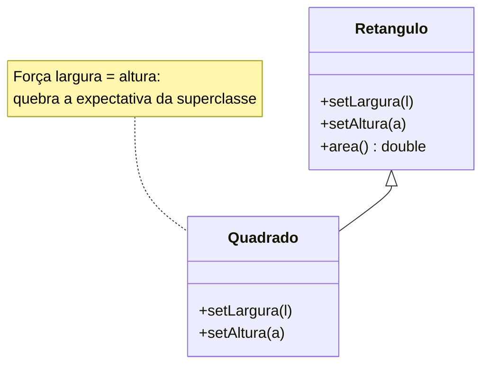
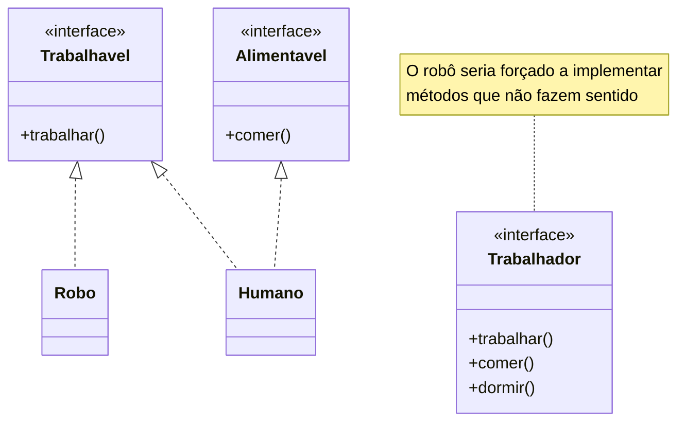
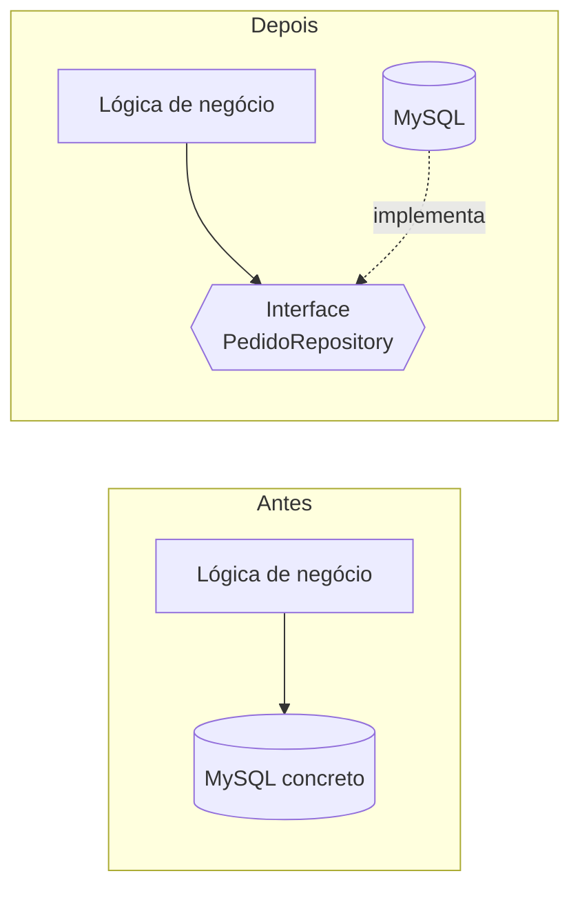

# 3. SOLID

O termo **SOLID** foi cunhado por Michael Feathers para os princípios sistematizados por Robert C. Martin. Os exemplos de linguagem e implementação desta página são **exemplos adicionais**.

## SRP — Princípio da Responsabilidade Única

Uma classe deve ter um único motivo para mudar, relacionado a um ator ou stakeholder.

**Antes:** `Funcionario` calcula salário, gera PDF e persiste dados. Mudanças na política salarial, no formato do relatório ou no banco afetam a mesma classe.

**Depois:** cada responsabilidade tem um módulo próprio; os três continuam trabalhando com o mesmo funcionário.

Código e teste: [`exemplos/solid/srp/`](../exemplos/solid/srp/).

## OCP — Princípio Aberto/Fechado

Um módulo deve estar aberto para extensão e fechado para modificação. Novas regras devem ser adicionáveis sem editar uma cadeia de condicionais existente.

**Antes:** cada novo tipo de desconto exige modificar `if/else`. **Depois:** cada desconto implementa a mesma operação.

Código e teste: [`exemplos/solid/ocp/`](../exemplos/solid/ocp/).

## LSP — Princípio da Substituição de Liskov

Uma subclasse deve poder substituir sua superclasse sem quebrar a corretude nem as expectativas de quem a utiliza. O princípio é associado a Barbara Liskov.

**Antes:** `Quadrado` herda de `Retangulo` e força largura e altura a permanecerem iguais, violando o contrato esperado por clientes de retângulos.

**Depois (exemplo adicional):** `Retangulo` e `Quadrado` implementam `Forma`, sem herança entre si.

Código e teste: [`exemplos/solid/lsp/`](../exemplos/solid/lsp/).

## ISP — Princípio da Segregação de Interfaces

Um cliente não deve depender de métodos que não usa. Prefira interfaces pequenas e focadas a uma interface ampla imposta a todos.

**Antes:** uma interface `Trabalhador` exige que um robô implemente `comer()` e `dormir()`. **Depois:** capacidades independentes são combinadas conforme necessário.

Código e teste: [`exemplos/solid/isp/`](../exemplos/solid/isp/).

## DIP — Princípio da Inversão de Dependência

Módulos de alto nível não devem depender de módulos de baixo nível; ambos devem depender de abstrações. Detalhes concretos dependem dessas abstrações.

**Antes:** a lógica de negócio instancia diretamente o MySQL. **Depois:** ela depende de um contrato de repositório, e o adaptador MySQL implementa esse contrato. A injeção da dependência permite testar a lógica sem o banco.

Código e teste: [`exemplos/solid/dip/`](../exemplos/solid/dip/).
