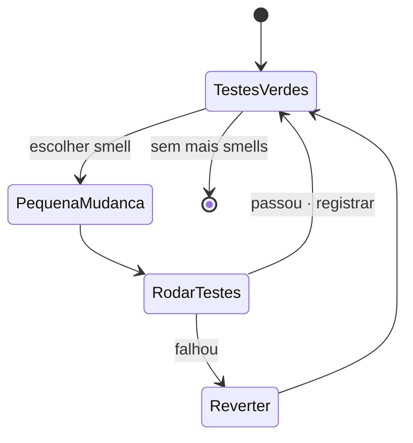

# 4. Refatoração e code smells

Refatorar é mudar a estrutura interna do software **sem alterar seu comportamento externo** (Martin Fowler). A prática segura depende de testes automatizados, mudanças pequenas e reversíveis e execução dos testes a cada passo.



## Smell → refatoração

Os recortes abaixo são **exemplos adicionais** em JavaScript. Cada mudança preserva uma saída verificável; os testes executáveis estão em [`exemplos/smells/`](../exemplos/smells/).

| Smell | Antes | Depois | Diagrama |
|---|---|---|---|
| Método longo | Um método valida, calcula e monta a resposta em sequência. | **Extract method:** separar validação, cálculo e formatação em funções nomeadas. | [`smell-metodo-longo.mmd`](../diagramas/smell-metodo-longo.mmd) |
| Classe grande | Uma classe reúne cadastro, cobrança e notificação. | Dividir responsabilidades em módulos coesos (SRP). | [`smell-classe-grande.mmd`](../diagramas/smell-classe-grande.mmd) |
| Condicionais por tipo | `if (tipo === ...)` escolhe o cálculo para cada categoria. | Polimorfismo / Strategy: delegar a regra para uma estratégia. | [`smell-condicionais.mmd`](../diagramas/smell-condicionais.mmd) |
| Lista longa de parâmetros | Uma função recebe campos de endereço individualmente. | Agrupar dados relacionados em um objeto de valor. | [`smell-parametros.mmd`](../diagramas/smell-parametros.mmd) |
| Duplicação | Regras de normalização repetidas em pontos diferentes. | Extrair método ou abstração comum. | [`smell-duplicacao.mmd`](../diagramas/smell-duplicacao.mmd) |
| Feature envy | Um método usa mais dados de outro objeto que do próprio. | Mover o método para a classe dona dos dados. | [`smell-feature-envy.mmd`](../diagramas/smell-feature-envy.mmd) |

### Exemplos de código

**Método longo — antes:**

```js
function totalDoPedido(itens) {
  if (itens.length === 0) throw new Error("Pedido vazio");
  let total = 0;
  for (const item of itens) total += item.preco * item.quantidade;
  return `R$ ${total.toFixed(2)}`;
}
```

**Depois:** extraia a validação, o cálculo e a formatação em funções com nomes que revelem cada intenção.

**Condicionais por tipo — antes:**

```js
function desconto(tipo, valor) {
  if (tipo === "natal") return valor * 0.9;
  if (tipo === "black-friday") return valor * 0.7;
  return valor;
}
```

**Depois:** selecione uma estratégia que implemente `aplicar(valor)`, como no exemplo de OCP. Isso aproxima o desenho do padrão Strategy.

**Lista longa de parâmetros — antes:**

```js
entregar(nome, rua, numero, cidade, cep);
```

**Depois:** `entregar(nome, endereco)`, onde `endereco` é um objeto de valor coeso.

**Feature envy — antes:** `Pedido` calcula o total consultando campos de cada item. **Depois:** cada `ItemPedido` calcula seu próprio subtotal; o pedido soma os subtotais.

As demais transformações seguem os mesmos critérios: preservar resultados, isolar responsabilidades e comprovar a equivalência por testes.
