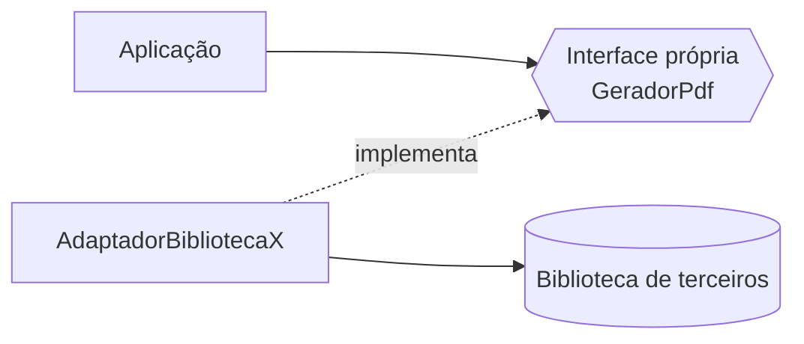

# 5. Reuso responsável

O reuso pode acontecer em diferentes granularidades:

1. Função ou classe dentro do mesmo sistema.
2. Biblioteca de terceiros.
3. Framework.
4. Serviço exposto por uma API.

Reusar código reduz duplicação, mas importar uma biblioteca não deve espalhar suas decisões por toda a aplicação. Encapsule dependências externas atrás de uma interface própria, alinhada ao DIP.

**Antes:** a aplicação chama diretamente a API específica da biblioteca em vários módulos; trocar de fornecedor exige alterar cada consumidor.

**Depois:** a aplicação usa `GeradorPdf`; um adaptador traduz a interface própria para a biblioteca escolhida. O teste pode injetar um gerador falso sem instalar ou chamar a biblioteca externa.

Também evite reaproveitar uma classe interna “por conveniência” quando isso acumula responsabilidades. Extraia uma abstração comum somente quando houver uma responsabilidade ou contrato realmente compartilhado.

Código e teste: [`exemplos/reuso/`](../exemplos/reuso/).
